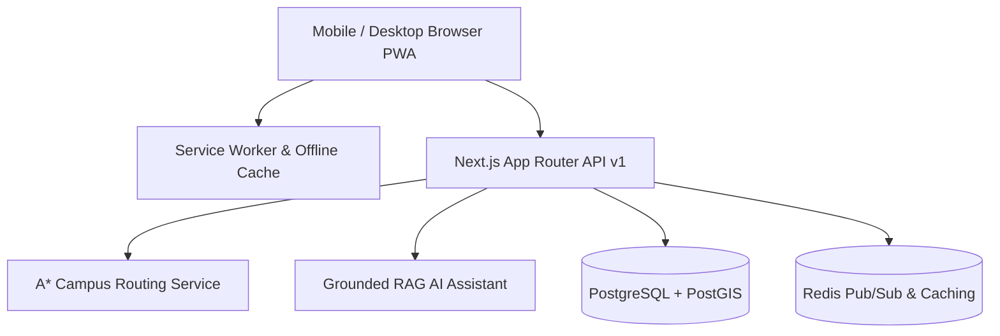

# 📐 System Architecture — Smart Campus Navigator

## 1. Architectural Philosophy

Smart Campus Navigator is architected around **Decoupled Accessibility**, **Unauthenticated Core Navigation**, and **Offline-First Resilience**.

---

## 2. Core Subsystems

### A. Frontend Layer (Next.js App Router)
- **Component Architecture**: Built using React 18, Tailwind CSS, Lucide Icons, and Framer Motion.
- **State Store**: Reactive in-memory subscriber pattern (`useCampusStore`) for real-time state sync across search, map, navigation, and dashboards.
- **Visual Design**: Dark constellation canvas background, mobile-first responsive layout (320px to 4K).

### B. Navigation Engine (`src/lib/navigation/router.ts`)
- **Topology**: Directed graph comprising `PathNode` (building entrances, corridors, stairwells, elevators) and `PathEdge` (weighted pathways).
- **Algorithm**: Dijkstra / A* shortest path with multi-criteria weights (stairs penalty, elevator penalty, accessible routes, temporary construction closures).

### C. Positioning Engine (`src/lib/location/positionProvider.ts`)
- **Adapter Pattern**: Implements `IPositionProvider` interface.
- **Supported Providers**: `GPSPositionProvider` (outdoor), `QRPositionProvider` (exact indoor recalibration), `BLEBeaconProvider` (IoT stub), `WiFiRTTProvider` (fine-ranging stub).

### D. Grounded AI Assistant (`src/app/api/v1/assistant/route.ts`)
- **Zero-Hallucination RAG**: Answers queries strictly by fetching verified records from SQL database and routing nodes.
- **Deep Links**: Emits direct actionable links (`[Navigate to LH-25]`) alongside confidence levels (High, Moderate, Low).
